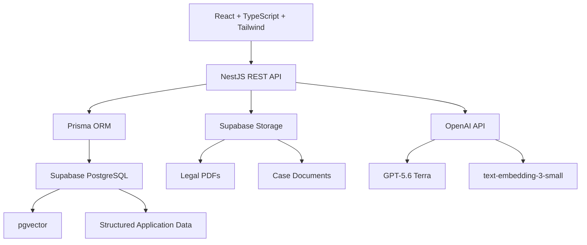

# ⚖️ LIS-BH — Legal Intelligence System

**LIS-BH** is a professional, private Legal AI platform designed for law firms, legal departments, government affairs teams, and organizations operating in Bahrain.

The platform combines **legal matter management, customer-controlled legal knowledge, semantic search, document intelligence, and source-backed AI assistance** in one secure enterprise application.

> **Core principle:** Search finds the law. AI explains it. The source proves it.

---

## ✨ Product Vision

LIS-BH is not a public legal-information website and not a generic AI chatbot.

Each customer receives a **separate deployment** with their own:

* PostgreSQL database
* Private file storage
* OpenAI API account
* Users
* Cases and documents
* Legal knowledge base

The customer decides exactly which legal resources the AI is allowed to use.

```text
Customer Legal Resources
        ↓
Text Extraction
        ↓
Legal Sections / Articles
        ↓
Embeddings
        ↓
Semantic Search
        ↓
Relevant Legal Sources
        ↓
AI Explanation
        ↓
Answer + Verifiable Citations
```

---

# 🚀 Core Capabilities

### ⚖️ Cases & Legal Matters

Manage legal matters across different legal practices without hardcoding the system for one type of law.

Supports:

* Matter reference numbers
* Case types and categories
* Status and priority
* Assigned lawyers
* Parties
* Documents
* Deadlines
* AI conversations
* Audit history

The data model remains generic enough for:

* Criminal law
* Labour law
* Commercial law
* Corporate law
* Civil matters
* Government affairs
* Regulatory work
* Internal legal departments

---

### 📚 Legal Resource Library

Administrators can upload approved legal resources such as:

* Laws
* Decrees
* Regulations
* Resolutions
* Circulars
* Legal opinions
* Policies
* Other approved legal material

Original files are stored securely while extracted legal text is processed for semantic search.

---

### 🧠 AI Legal Assistant

Users can ask legal questions in natural Arabic or English.

The planned RAG workflow is:

```text
Question
   ↓
Question Embedding
   ↓
pgvector Semantic Search
   ↓
Most Relevant Legal Chunks
   ↓
GPT
   ↓
Source-Backed Answer
```

The AI is designed to:

* Use approved legal resources as its primary basis
* Avoid inventing article numbers
* Avoid unsupported citations
* Clearly indicate insufficient evidence
* Return the exact legal sources used
* Support Arabic and English

---

### 📄 AI Document Analysis

Case documents can be processed and reused for AI functionality such as:

* Summarization
* Important information extraction
* Document Q&A
* Party identification
* Date identification
* Relevant law discovery
* Arabic ↔ English translation
* Legal drafting
* Deadline detection

Extracted document text is stored so the same PDF does not need to be processed repeatedly.

---

### 📅 Legal Deadlines

Track confirmed deadlines linked to legal matters.

Examples:

* Court responses
* Government responses
* Regulatory submissions
* Hearings
* Legal review deadlines
* Internal legal deadlines

AI may eventually **suggest** deadlines from uploaded documents, but the user must confirm them before they become official tracked deadlines.

---

### 🔐 Administration

LIS-BH intentionally uses a simple access model.

#### ADMIN

Can:

* Create users
* Activate/deactivate users
* Manage legal resources
* Manage administrative functionality
* Use all normal legal functionality

#### USER

Can:

* Work with legal matters
* Upload case documents
* Search legal resources
* Use AI tools
* Work with deadlines
* Assign eligible cases to themselves

There is **no public signup**.

---

# 🛠️ Technology Stack

## Frontend

* React
* TypeScript
* Vite
* Tailwind CSS
* Responsive UI
* Arabic RTL support
* English LTR support

## Backend

* NestJS
* TypeScript
* REST APIs
* Prisma ORM
* DTO validation
* JWT authentication
* Swagger / OpenAPI

## Database

* PostgreSQL
* Supabase
* pgvector
* pgcrypto
* Prisma migrations

## File Storage

* Supabase Storage

Planned for:

```text
legal-resources/
case-documents/
```

Buckets will remain private.

## AI

* OpenAI API
* GPT-5.6 Terra
* `text-embedding-3-small`

All OpenAI requests are performed from the **NestJS backend**.

The OpenAI API key is never exposed to React.

---

# 🏗️ Architecture



The frontend never communicates directly with the production database.

```text
React
  ↓
NestJS
  ↓
Prisma
  ↓
Supabase PostgreSQL
```

---

# 🗄️ Database

The core application schema currently contains:

```text
users
password_reset_tokens
audit_logs

legal_resources
legal_chunks

cases
case_parties
case_documents

ai_conversations
ai_messages
ai_citations

deadlines
```

Prisma migration history is committed to the repository so the same schema can be recreated for customer deployments.

---

## Legal Knowledge Structure

```text
legal_resources
      │
      └── legal_chunks
              │
              └── embedding vector(1536)
```

Each uploaded legal resource can be divided into structured chunks such as:

```text
Article 1
Article 2
Article 3
Chapter
Section
Clause
```

When structured splitting is unavailable, sensible overlapping chunks can be used.

---

# 🔎 Semantic Search

LIS-BH uses PostgreSQL + pgvector instead of a separate vector database.

For each legal chunk:

```text
Legal text
    ↓
text-embedding-3-small
    ↓
1536-dimensional vector
    ↓
PostgreSQL / pgvector
```

For each question:

```text
User Question
    ↓
Question Embedding
    ↓
Similarity Search
    ↓
Top Relevant Legal Chunks
```

Embeddings are generated once and stored permanently unless the underlying legal content changes.

---

# 🧾 Auditing

Legal software requires traceability.

Important records contain:

```text
created_by
updated_by
created_at
updated_at
```

The system also maintains dedicated audit records such as:

```text
LOGIN
USER_CREATED
USER_DEACTIVATED
RESOURCE_UPLOADED
RESOURCE_ARCHIVED
RESOURCE_DELETED
CASE_CREATED
CASE_UPDATED
DOCUMENT_UPLOADED
```

Users should normally be **deactivated rather than deleted** so historical audit relationships remain intact.

---

# 🔐 Authentication

Authentication currently uses:

```text
Email
Password
JWT
```

Security measures include:

* Password hashing with bcrypt
* Strong server-side JWT secret
* Expiring JWT access tokens
* Bearer authentication
* Active-user verification on protected requests
* Current role verification from the database
* No passwords stored inside JWTs
* No secrets exposed to React
* Login audit logging

Current authentication endpoints:

```http
POST /auth/login
GET  /auth/me
```

Public signup is intentionally not supported.

---

# 📖 Swagger API Documentation

When the backend is running locally:

```text
http://localhost:3000/api/docs
```

Swagger is used to:

* View available API endpoints
* Inspect request DTOs
* Test APIs
* Authenticate using JWT Bearer tokens
* Validate backend functionality before frontend integration

---

# 📁 Repository Structure

```text
LIS-BH/
│
├── client/
│   ├── src/
│   ├── public/
│   ├── package.json
│   └── vite.config.ts
│
├── server/
│   ├── prisma/
│   │   ├── migrations/
│   │   └── schema.prisma
│   │
│   ├── scripts/
│   │   └── create-admin.ts
│   │
│   ├── src/
│   │   ├── auth/
│   │   ├── prisma/
│   │   ├── generated/
│   │   ├── app.module.ts
│   │   └── main.ts
│   │
│   ├── package.json
│   └── prisma.config.ts
│
├── .gitignore
└── README.md
```

As development progresses, backend modules will expand to include:

```text
users/
legal-resources/
cases/
documents/
ai/
embeddings/
search/
storage/
deadlines/
common/
```

---

# ⚙️ Local Development

## Prerequisites

Install:

* Node.js
* npm
* Git

You also need access to the LIS-BH Supabase development environment.

---

## 1. Clone the repository

```bash
git clone <repository-url>
cd LIS-BH
```

---

## 2. Backend

```bash
cd server
npm install
```

Create:

```text
server/.env
```

Example:

```env
NODE_ENV=development
PORT=3000

DATABASE_URL="your-supabase-postgresql-url"

JWT_SECRET="your-long-random-secret"
JWT_EXPIRES_IN="28800"

FRONTEND_URL="http://localhost:5173"
```

Never commit real environment variables.

Generate Prisma Client:

```bash
npx prisma generate
```

Run migrations when required:

```bash
npx prisma migrate dev
```

Start NestJS:

```bash
npm run start:dev
```

Backend:

```text
http://localhost:3000
```

Swagger:

```text
http://localhost:3000/api/docs
```

---

## 3. Frontend

From the repository root:

```bash
cd client
npm install
npm run dev
```

Frontend:

```text
http://localhost:5173
```

---

# 👤 Initial Administrator

There is no signup page.

The first administrator is created during installation using:

```text
server/scripts/create-admin.ts
```

Temporary administrator credentials are supplied through environment variables during setup.

Passwords are hashed using bcrypt before being written to PostgreSQL.

After creation, temporary plain-text setup credentials should be removed from `.env`.

Future users will be created internally through the Admin interface.

---

# 🛡️ Security Principles

LIS-BH is designed for private legal information.

Core security requirements include:

* Private customer deployments
* Separate customer databases
* Private object storage
* Server-side secrets
* Server-side OpenAI access
* Password hashing
* JWT expiration
* DTO validation
* Strict CORS
* File validation
* File-size restrictions
* Secure password-reset tokens
* Audit logging
* HTTPS in production
* Database backups
* No public signup
* No secrets committed to Git

---

# 🏢 Customer Deployment Model

LIS-BH is currently **not a multi-tenant SaaS platform**.

We maintain one reusable codebase:

```text
LIS-BH Codebase
       │
       ├── Customer A Deployment
       │     ├── Supabase A
       │     ├── Storage A
       │     ├── OpenAI Key A
       │     └── Domain A
       │
       └── Customer B Deployment
             ├── Supabase B
             ├── Storage B
             ├── OpenAI Key B
             └── Domain B
```

This provides strong physical separation between customer environments without introducing unnecessary multi-tenant complexity.

---

# 💰 Cost-Efficient AI Design

LIS-BH follows several principles to control AI usage:

1. Legal content is embedded once.
2. Existing embeddings are reused.
3. Only the user's question requires a new embedding.
4. Only highly relevant chunks are retrieved.
5. Entire law books are not sent to the AI unnecessarily.
6. CRUD operations do not use AI.
7. Dashboard statistics do not use AI.
8. PostgreSQL + pgvector removes the need for a separate vector database.
9. AI prompts remain focused.
10. Customer production environments use the customer's own OpenAI account.

---

# ✅ Current Development Status

### Foundation

* [x] React + TypeScript + Vite
* [x] Tailwind CSS
* [x] NestJS + TypeScript
* [x] Supabase PostgreSQL
* [x] Prisma ORM
* [x] pgvector
* [x] pgcrypto
* [x] Prisma migrations
* [x] Core database schema

### Authentication

* [x] Initial ADMIN creation
* [x] Email/password login
* [x] bcrypt password verification
* [x] JWT authentication
* [x] Active-user verification
* [x] Current-user endpoint
* [x] Login audit logging
* [x] Swagger integration
* [ ] Forgot password
* [ ] Reset password

### Backend Modules

* [ ] Users API
* [ ] Legal Resource API
* [ ] Supabase Storage integration
* [ ] PDF extraction
* [ ] Legal chunk processing
* [ ] Embedding service
* [ ] Semantic search
* [ ] RAG Legal AI
* [ ] Citation verification
* [ ] Cases API
* [ ] Case Parties API
* [ ] Case Documents API
* [ ] AI Conversations
* [ ] Document Analysis
* [ ] Deadlines API

### Frontend

* [ ] Authentication UI
* [ ] Dashboard
* [ ] Cases workspace
* [ ] Case details
* [ ] Legal Resource Library
* [ ] Legal Resource Viewer
* [ ] AI Legal Assistant
* [ ] Document Analysis workspace
* [ ] Deadlines / Calendar
* [ ] Admin Users
* [ ] Audit Log UI
* [ ] Arabic RTL
* [ ] English LTR
* [ ] Final premium UI polish

---

# 🗺️ Development Roadmap

```text
Database Foundation
       ✅
       ↓
Authentication
       🚧
       ↓
Users
       ↓
Legal Resources
       ↓
Storage + PDF Processing
       ↓
Chunking + Embeddings
       ↓
Semantic Search
       ↓
RAG + Citations
       ↓
Cases + Parties + Documents
       ↓
AI Document Tools
       ↓
Deadlines
       ↓
Professional React UI
       ↓
Security + Testing
       ↓
Production Deployment
```

---

# 🎯 Critical Technical Flow

The most important workflow in LIS-BH is:

```text
Upload Legal PDF
        ↓
Store Original File
        ↓
Extract Text
        ↓
Create Legal Chunks
        ↓
Generate Embeddings
        ↓
Store in pgvector
        ↓
Ask Legal Question
        ↓
Retrieve Relevant Chunks
        ↓
Generate AI Answer
        ↓
Verify Citations
        ↓
Open Original Source
```

Once this workflow operates reliably, the core Legal AI product is working.

---

# ⚠️ Important Development Principles

LIS-BH intentionally avoids unnecessary complexity.

We are **not** building:

* Public signup
* Subscription billing
* Multi-tenant SaaS billing
* Complex permission designers
* Microservices
* Kubernetes
* Redis without justification
* Separate vector databases
* Huge ERP functionality
* Public legal-information portals
* Automatic legal web scraping
* Expensive OCR infrastructure initially
* Multiple unnecessary AI models
* Mobile applications in the first version

The goal is:

> **Small architecture. Professional quality. Secure data. Reliable AI. Beautiful user experience.**

---

# ⚖️ Disclaimer

LIS-BH is an AI-assisted legal productivity and research platform.

AI-generated outputs are intended to assist qualified legal professionals and should be reviewed against the cited source material before being relied upon for legal decisions.

The platform is designed to surface and explain approved legal resources — not to replace professional legal judgment.

---

## LIS-BH

**Legal Intelligence System for Bahrain**

Private legal knowledge.
Semantic search.
Source-backed AI.
Professional legal workflow.
